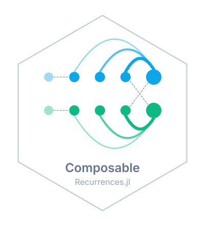
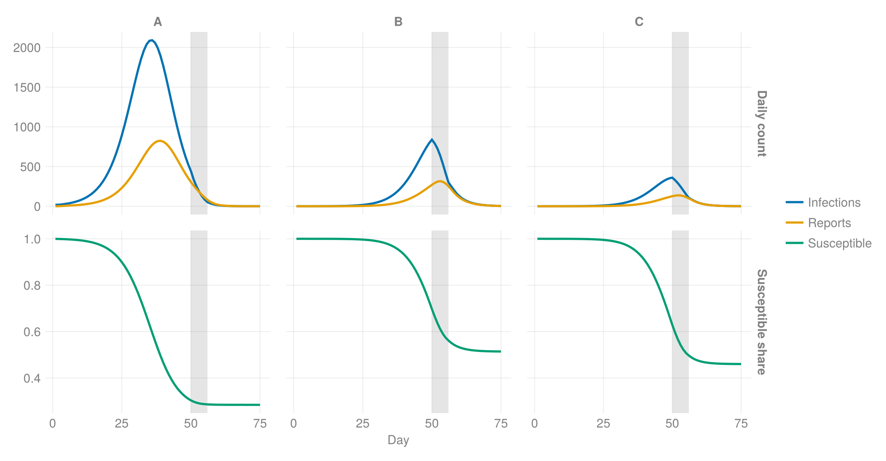

# ComposableRecurrences 

<!-- badges:start -->
| **Documentation** | **Build Status** | **Code Quality** | **License & DOI** | **Downloads** |
|:-----------------:|:----------------:|:----------------:|:-----------------:|:-------------:|
| [](https://composablerecurrences.epiaware.org/stable/) [](https://composablerecurrences.epiaware.org/dev/) | [](https://github.com/EpiAware/ComposableRecurrences.jl/actions/workflows/test.yaml) [](https://codecov.io/gh/EpiAware/ComposableRecurrences.jl) [](https://github.com/EpiAware/ComposableRecurrences.jl/actions/workflows/ad.yaml) | [](https://github.com/fredrikekre/Runic.jl) [](https://github.com/JuliaTesting/Aqua.jl) [](https://github.com/aviatesk/JET.jl) | [](https://opensource.org/licenses/MIT) | [](https://juliapkgstats.com/pkg/ComposableRecurrences) [](https://juliapkgstats.com/pkg/ComposableRecurrences) |

| ForwardDiff | ReverseDiff (tape) | ReverseDiff (compiled) | Enzyme forward | Enzyme reverse | Mooncake reverse | Mooncake forward |
|:---:|:---:|:---:|:---:|:---:|:---:|:---:|
| [](https://app.codecov.io/gh/EpiAware/ComposableRecurrences.jl?flags%5B0%5D=ad-forwarddiff) | [](https://app.codecov.io/gh/EpiAware/ComposableRecurrences.jl?flags%5B0%5D=ad-reversediff) | [](https://app.codecov.io/gh/EpiAware/ComposableRecurrences.jl?flags%5B0%5D=ad-reversediff-compiled) | [](https://app.codecov.io/gh/EpiAware/ComposableRecurrences.jl?flags%5B0%5D=ad-enzyme-forward) | [](https://app.codecov.io/gh/EpiAware/ComposableRecurrences.jl?flags%5B0%5D=ad-enzyme-reverse) | [](https://app.codecov.io/gh/EpiAware/ComposableRecurrences.jl?flags%5B0%5D=ad-mooncake-reverse) | [](https://app.codecov.io/gh/EpiAware/ComposableRecurrences.jl?flags%5B0%5D=ad-mooncake-forward) |
<!-- badges:end -->
[](https://github.com/EpiAware/ComposableRecurrences.jl/blob/main/test/reactant/RESULTS.md)

Fast, [composable](https://composablerecurrences.epiaware.org/stable/getting-started/api-overview/) and [differentiable](https://composablerecurrences.epiaware.org/stable/explanation/adjoints-and-backends/) recurrences and convolutions in Julia.

## Why ComposableRecurrences?

- A recurrence computes each value from its own past values, such as infections from earlier infections.
  A convolution weights the past values of another series, such as reported cases from earlier infections.
- Both are usually hand-written loops, rewritten for each model.
  `Recurrence` and `Convolution` express them as two operators, for one series or many coupled series.
- Coupling between series, finite pools and bounds are added by composing small couplings and modifiers.
  Users can write their own.
- The forward run and gradients under ForwardDiff, Mooncake and Enzyme are close to or faster than a hand-written loop; see the [performance figure](https://composablerecurrences.epiaware.org/stable/getting-started/#overview-performance).

## Getting started

Three towns share an outbreak.
Infections in each town come from earlier infections in that town and, through travel, in the other towns.
Each town has a finite number of people who can be infected.
A share of infections is reported after a delay.
An intervention from day 50 lowers the reproduction number in every town.

```math
\begin{aligned}
v_{t,i} &= R_{t,i} \sum_{j=1}^{3} K_{ij} \sum_{l=1}^{L} g_l \, I_{t-l,j}, \\
I_{t,i} &= s_{t-1,i} \big(1 - e^{-v_{t,i} / N_i}\big), \qquad s_{t,i} = s_{t-1,i} \, e^{-v_{t,i} / N_i}, \\
C_{t,i} &= \rho \sum_{l=0}^{L_w - 1} w_l \, I_{t-l,i}, \\
K_{ij} &= 0.998 \, \delta_{ij} + 0.002 \, \frac{G_{ij}}{\sum_{m} G_{im}}, \qquad G_{ij} = \frac{N_j}{d_{ij}^2} \text{ for } i \neq j, \\
R_{t,i} &= 1.8 - \min\Big(\max\Big(\frac{t - 50}{6}, 0\Big), 1\Big),
\end{aligned}
```

where $I_{t,i}$ is the number of infections in town $i$ on day $t$, $C_{t,i}$ the number of reports and $R_{t,i}$ the reproduction number.
The infection pressure is $v_{t,i}$, and the susceptible pool $s_{t,i}$ starts at the population $N_i$.
The generation interval has weight $g_l$ on lag $l$, the reporting delay has weight $w_l$, and a share $\rho = 0.4$ of infections is reported.
The gravity coupling $K_{ij}$ comes from the populations and the distances $d_{ij}$ between towns, with $G_{ii} = 0$.
The term $\delta_{ij}$ is 1 when $i = j$ and 0 otherwise.
Town A has 10 infections on each of the six days before day 1, and the other towns none.

```julia
using ComposableRecurrences
using ComposableRecurrences: Depletion

gi = [0.05, 0.2, 0.3, 0.25, 0.12, 0.08]
T = 75
towns = ["A", "B", "C"]
pop = [60_000.0, 25_000.0, 10_000.0]
dist = [0.0 20.0 45.0; 20.0 0.0 30.0; 45.0 30.0 0.0]
gravity = [a == b ? 0.0 : pop[b] / dist[a, b]^2 for a in 1:3, b in 1:3]
K = 0.998 * [a == b for a in 1:3, b in 1:3] + 0.002 * gravity ./ sum(gravity; dims = 2)
seed = [fill(10.0, 1, 6); zeros(2, 6)]
R = [1.8 - clamp((t - 50) / 6, 0, 1) for _ in towns, t in 1:T]

renewal = Recurrence(gi; coupling = K, modifiers = (Depletion(PerStratum(pop)),))
delay = Convolution([0.0, 0.1, 0.25, 0.3, 0.2, 0.1, 0.05])
infections = renewal(R; history = seed)
reports = delay(infections; gain = 0.4)
```



The [getting started guide](https://composablerecurrences.epiaware.org/stable/getting-started/#overview-build) builds the model one part at a time, and adds the plot code, performance and gradients.

## Related packages

- [ComposableTuringIDModels.jl](https://composableturingidmodels.epiaware.org) builds infectious disease models from renewal, delay and latent process components.
- [ConvolvedDistributions.jl](https://convolveddistributions.epiaware.org) builds convolutions of distributions, such as the total of two independent delays.
- [CensoredDistributions.jl](https://censoreddistributions.epiaware.org) discretises delay distributions into the probability mass functions these operators take as kernels.

## Where to learn more

- [Developer documentation](https://composablerecurrences.epiaware.org/stable/developer/), including how to add your own modifiers and couplings
- [GitHub Repository](https://github.com/EpiAware/ComposableRecurrences.jl)

<!-- standard-sections:start -->
<!-- MANAGED by EpiAwarePackageTools.scaffold — do not edit between the
     markers. These standard sections are re-rendered on every update;
     edit the package-owned sections outside them, or CITATION.cff. -->

## Part of the EpiAware ecosystem

ComposableRecurrences is part of [EpiAware](https://epiaware.org), a set of composable tools for infectious disease modelling. See the [other packages](https://github.com/EpiAware) in the ecosystem.

## Contributing

We welcome contributions and new contributors! Please open an issue or pull request on [GitHub](https://github.com/EpiAware/ComposableRecurrences.jl). This package follows [ColPrac](https://github.com/SciML/ColPrac) and is formatted with [Runic](https://github.com/fredrikekre/Runic.jl).

## How to cite

If you use ComposableRecurrences in your work, please cite it. Citation metadata lives in [`CITATION.cff`](https://github.com/EpiAware/ComposableRecurrences.jl/blob/main/CITATION.cff), which GitHub renders as a "Cite this repository" button on the repository page.

## Code of conduct

Please note that the ComposableRecurrences project is released with a [Contributor Code of Conduct](https://github.com/EpiAware/.github/blob/main/CODE_OF_CONDUCT.md). By contributing, you agree to abide by its terms.
<!-- standard-sections:end -->
