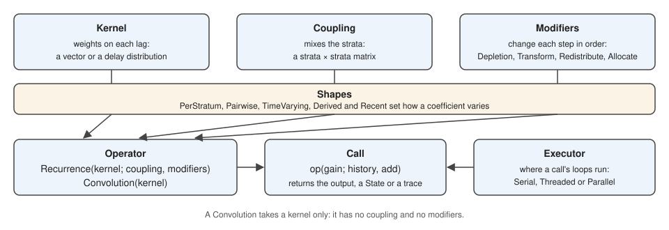

# [API overview](@id api-overview)

Each part of the package has a short section here, with a link to the page that covers it in full.
One small model shows how the parts fit together.

Some public names are not exported, so `using ComposableRecurrences` does not bring them in.
They are written here without the package prefix, and `using ComposableRecurrences: Depletion, Floor, Recent` loads them.
Internal names, such as `ComposableRecurrences.State`, keep the prefix.
The neural network package Lux also exports a `Recurrence`, so with both loaded write [`ComposableRecurrences.Recurrence`](@ref Recurrence).

## [How the parts fit together](@id overview-map)

[`Recurrence`](@ref) computes each value from its own past values, and [`Convolution`](@ref) weights the past values of an input series.
Each is built from a kernel, and a recurrence also from a coupling, which mixes the strata, and modifiers, which change each step's value.
A shape sets how these coefficients vary across strata and time, and an executor sets where a call's loops run.



## [A worked example](@id overview-example)

The example uses `gi`, `pop`, `K`, `seed` and `R` from the model of [Three towns, step by step](@ref tutorial-three-towns).
They are a generation interval, each town's population, a gravity coupling, the seed infections and the reproduction number.

```@setup api-overview
using ComposableRecurrences
include(
    joinpath(pkgdir(ComposableRecurrences), "docs", "getting_started_model.jl")
)
```

```@example api-overview
using ComposableRecurrences
using ComposableRecurrences: Depletion
renewal = Recurrence(
    gi; coupling = K, modifiers = (Depletion(PerStratum(pop)),)
)
infections = renewal(R; history = seed)
delay = Convolution([0.0, 0.1, 0.25, 0.3, 0.2, 0.1, 0.05])
reports = delay(infections; gain = 0.4, history = seed)
size(reports)
```

Each part of this model has its own section below.

- `gi` is the kernel of the recurrence, and the vector of delays the kernel of the convolution.
- `K` is the coupling, a matrix of weights between the three towns.
- `Depletion(PerStratum(pop))` is a modifier, and `PerStratum` is a shape: one population per town.
- `renewal(R; history = seed)` and `delay(infections; ...)` are calls, each returning a towns × days matrix.

## [A step](@id overview-step)

Both operators compute one step at a time; [A step](@ref explanation-step) gives the equations.

## [Operators](@id overview-operators)

[Building an operator](@ref explanation-build) lists each operator's keywords.

## [Calls](@id overview-calls)

[Calls](@ref explanation-calls) lists every call form, with what each returns.

## [Shapes](@id overview-shapes)

[Slots and shapes](@ref explanation-slots) says which wrapper each coefficient takes, and [Data shapes](@ref explanation-data-shapes) gives the shapes of the gain and `add`.

## [Delay distributions](@id overview-delays)

[Delay distributions as kernels](@ref explanation-delays) shows how a distribution becomes a kernel.

## [Couplings](@id overview-couplings)

[Where the coupling acts](@ref explanation-coupling) lists the coupling types and where a per-stratum coefficient belongs.

## [Modifiers](@id overview-modifiers)

[Built-in modifiers](@ref explanation-builtin-modifiers) lists each modifier, and [Order](@ref explanation-modifier-order) says why their order matters.

## [Depletion forms](@id overview-variants)

[Depletion forms](@ref explanation-depletion-forms) lists how a pool can give up a step's demand.

## [Time-series processes](@id overview-time-series)

[Time-series processes](@ref explanation-time-series) writes random walks, autoregressions and moving averages as operators.

## [Executors](@id overview-executors)

[Executors](@ref executors) says how to choose where loops run, and [Adjoints and backends](@ref adjoints-backends) how gradients are computed.

## [Writing your own](@id overview-own)

[Writing new types](@ref extending) shows how to add a coupling, modifier or depletion form.
