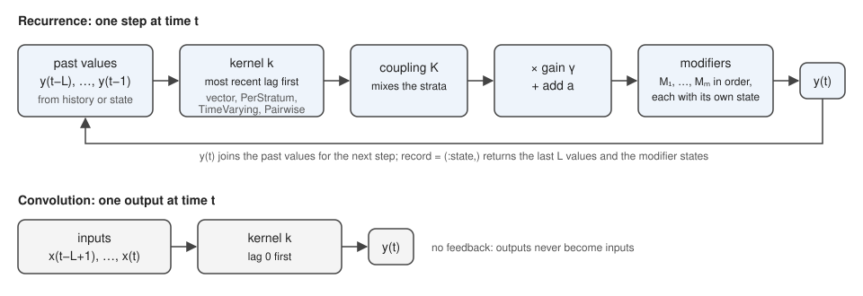

# [Operators](@id explanation-operators)

A recurrence reads its own past outputs and a convolution an input series; the [API overview](@ref api-overview) shows where they fit.

```@example operators
using ComposableRecurrences
using ComposableRecurrences: exponential_history, Depletion
```

## [A step](@id explanation-step)

[`Recurrence`](@ref) and [`Convolution`](@ref) compute their outputs one step at a time, with time the integer step ``t`` counted from 1 in the model's [time unit](@ref time-units).
Each series run side by side, such as one per town, is a stratum.
A convolution has no coupling and no modifiers.



A call runs from step `start` to step `stop`.
For each step ``t`` of that range, a recurrence computes

```math
\begin{aligned}
p_t &= \sum_{l=1}^{L} k_l \, y_{t-l} \\
v_t &= \gamma_t \odot K_t \, p_t + a_t \\
y_t &= M_m \circ \dots \circ M_1 (v_t)
\end{aligned}
```

and a convolution computes

```math
y_t = \gamma_t \odot \sum_{l=0}^{L-1} k_l \, x_{t-l} + a_t ,
```

where ``y_t`` is the output, one entry per stratum, ``x_t`` the input of a convolution and ``p_t`` the weighted sum of past outputs.
The kernel has weight ``k_l`` on lag ``l`` over ``L`` lags, ``K_t`` is the coupling, ``\gamma_t`` the gain and ``a_t`` the `add` input.
The value before the modifiers ``M_1, \dots, M_m``, which act in order, is ``v_t``, and ``\odot`` multiplies element by element.
For a recurrence the `history` holds the outputs before `start`, and for a convolution the inputs before time 1.
[Where the coupling acts](@ref explanation-coupling) writes the step stratum by stratum, and [Order](@ref explanation-modifier-order) writes the modifiers' part.

## [Building an operator](@id explanation-build)

Each operator is built once from a kernel and then called like a function.

```@example operators
delay = Convolution([0.0, 0.1, 0.25, 0.3, 0.2, 0.1, 0.05])
delay([10.0, 20.0, 30.0])
```

The constructors are [`Recurrence(kernel; lags, step, coupling, modifiers)`](@ref Recurrence) and [`Convolution(kernel; lags, step, method)`](@ref Convolution).
`lags` and `step` apply when the kernel is a [delay distribution](@ref explanation-delays).
The keyword `method` sets how a convolution sums its lags: [`Direct()`](@ref ComposableRecurrences.Direct) sums them one by one, and [`FFTMethod()`](@ref ComposableRecurrences.FFTMethod) uses a fast Fourier transform.
By default a convolution takes the transform for a kernel of at least 300 lags over at least 1000 steps.

An operator, modifier or shape wrapper displays in the REPL as one line with its size and parts, such as `Convolution(7 lags)` for `delay`.
`repr` and `string` keep the constructor form.

## [Calls](@id explanation-calls)

A recurrence `renewal` takes its gain first, and a convolution `delay` takes its input first and its gain as a keyword.

| Call | Returns |
|:--|:--|
| [`renewal(gain; history, add, start, stop)`](@ref Recurrence) | the run, a vector or strata × time |
| [`delay(x; gain, add, history, start, stop)`](@ref Convolution) | an array shaped like `x` |
| [`renewal(gain; history, record = (:state, :trace))`](@ref Recurrence) | `(; y, state, trace)`, with the `State` to [resume from](@ref explanation-history-state) |
| [`ComposableRecurrences.contributions(delay, x; ...)`](@ref ComposableRecurrences.contributions) | each lag's term before the sum |
| [`delay'(x; tail, start, stop)`](@ref Base.transpose(::Convolution)) | the transpose, which reads `x` forward from each time |
| [`pressure(renewal, y; history, start)`](@ref ComposableRecurrences.pressure) | ``K_t p_t`` recomputed from `y`; `y` over it is the gain as run |
| [`ComposableRecurrences.window_sums(y, ends; dims)`](@ref ComposableRecurrences.window_sums) | the sums of `y` over windows ending at `ends` |

The keyword `stop` defaults to the common length of the time-indexed inputs, and inputs of different lengths without a `stop` are an error.
Without a gain, a recurrence takes a gain of 1.
A `trace` holds one matrix per modifier in `trace.modifiers`, with a column per step, and the pressure of each step in `trace.pressure`, shaped like `y`.

The transpose sums forward in time from each ``t``.
For a reporting delay ``w_l`` over ``L_w`` lags and data up to time ``T``, the share of the infections at time ``t`` reported by ``T`` is

```math
c_t = \sum_{l=0}^{\min(L_w, T - t + 1) - 1} w_l ,
```

and `delay'(ones(T))` returns ``c_1, \dots, c_T``.
For a delay whose weights sum to 1, it is 1 up to ``T - L_w + 1`` and falls to ``w_0`` at ``T``.

## [A recurrence is a convolution of its own outputs](@id explanation-lag-origin)

A recurrence reads its own past outputs, so a recurrence with kernel ``k`` is a convolution of its outputs with ``k`` shifted by one lag, times the gain ``\gamma_t``:

```math
y_t = \gamma_t \sum_{l=1}^{L} k_l \, y_{t-l} = \gamma_t \sum_{l=0}^{L} \tilde k_l \, y_{t-l},
\qquad \tilde k = (0, k_1, \dots, k_L),
```

where ``y_t`` is the output at time ``t``, ``k_l`` the kernel weight on lag ``l``, and ``\tilde k`` the convolution kernel `vcat(0, k)`.
A recurrence's value cannot depend on itself in the same step, so its first weight is on the previous value.
A convolution can weight the input at the current time, as a reporting delay of zero does.
Both are written as the quantity is usually written, so a generation interval or a delay goes in unchanged.

```@example operators
k = [0.2, 0.5, 0.3]
gain = fill(1.3, 10)
seed = [1.0, 1.0, 1.0]
y = Recurrence(k)(gain; history = seed)
p = Convolution(vcat(0, k))(y; history = seed)
y ≈ gain .* p
```

The same identity recovers any quantity inside a step from the outputs.
Operators return only their outputs, so recompute an intermediate this way rather than asking the operator for it.

## [Time base](@id explanation-time-base)

Every time-indexed input is read at absolute time ``t``, counted from 1.
This holds for `gain`, `add`, a convolution's `x` and every [`TimeVarying`](@ref) kernel, coupling or parameter.
`start` and `stop` choose which times are computed, not how the inputs are read.
So a call from `start = 4` reads `gain[4]` at its first step, and the output has `stop - start + 1` entries.
With ``h_{t}`` the history value at time ``t``, that first step is

```math
y_4 = \gamma_4 \sum_{l=1}^{3} k_l \, h_{4-l}.
```

```@example operators
gain = collect(range(1.5, 0.8; length = 10))
r = Recurrence(k)
y_late = r(gain; history = seed, start = 4)
length(y_late), y_late[1] ≈ gain[4] * sum(k .* reverse(seed))
```

One time base means a series built in sections lines up with one built whole.
A resumed call, a later `start` and a forecast past the data all read the same column for the same time.

## [History and state](@id explanation-history-state)

The `history` holds the values before `start`, oldest first.
The recursion reads only the last ``L`` of them, and zeros stand for any that are missing.
A modifier's `Init` reads the whole history, so a modifier can set its starting state from more than ``L`` values.

A [`State`](@ref ComposableRecurrences.State) holds everything the next step reads: the last ``L`` outputs, the state of each modifier and the next time.
So a call that resumes from a `State` gives the values one call over both ranges would.
A forecast is then a second call, not a second model.

```@example operators
modifiers = (Depletion(50.0; pools = (S = 50.0 - sum(seed),)),)
r = Recurrence(k; modifiers)
whole = r(fill(1.6, 20); history = seed)
fit, state = r(fill(1.6, 20); history = seed, stop = 12, record = (:state,))
forecast = r(fill(1.6, 20); state)
whole ≈ vcat(fit, forecast)
```

The pool in the `State` carries the depletion over, so the forecast starts from the pool the fit left.
A modifier parameter read from past outputs, [`Recent`](@ref ComposableRecurrences.Recent), deepens the window past ``L``, and the `State` keeps the deeper window.

## [Seeding](@id explanation-seeding)

A recurrence needs values before its first step, in one of two places.

- Before time 1, as `history` with `start = 1`.
  The run starts at time 1, so the gain and other inputs cover the run only.
- At times 1 to ``m``, as `history` with `start = m + 1`.
  The inputs then cover the seed times too, which a [`Primary`](@ref ComposableRecurrences.Primary) kernel needs, since only times from 1 have a column.

[`exponential_history`](@ref ComposableRecurrences.exponential_history) builds a seed that grows at a fixed rate, as at the start of an epidemic.
A seed drawn from a finite pool should leave the pool smaller; the `pools` keyword of [`Depletion`](@ref ComposableRecurrences.Depletion) does this.

```@example operators
seed = exponential_history(2.0, 0.1, length(k))
gain = fill(1.2, 13)
before = Recurrence(k)(gain[4:end]; history = seed)
after = Recurrence(k)(gain; history = seed, start = 4)
before ≈ after
```

The two placements give the same run whenever the inputs over the seed times are not read.

## [What a call returns](@id explanation-returns)

A recurrence returns the run alone, from `start` to `stop`.
With `include_history = true` it returns the seed followed by the run, which is the whole series a later operator should see.
Each trace then has zero columns over the seed, so it shares the output's times.
This works with a view as the history on every backend, which `vcat` does not under Enzyme.

```@example operators
whole = Recurrence(k)(gain; history = seed, include_history = true)
whole == vcat(seed, Recurrence(k)(gain; history = seed))
```

A convolution's `history` holds inputs before time 1, which it reads but does not return.

So a delay after a recurrence takes the seed as its own history.
Delaying the seed and run together and dropping the seed times gives the same reports.

```@example operators
delay = Convolution([0.1, 0.4, 0.3, 0.2])
infections = Recurrence(k)(gain; history = seed)
reports = delay(infections; history = seed)
joined = Recurrence(k)(gain; history = seed, include_history = true)
reports ≈ delay(joined)[(length(seed) + 1):end]
```

Pass the seed as history when the reports should cover the run only, and join it in front when they should cover the seed times too.

## [Output number type](@id explanation-eltype)

The buffer eltype promotes [`ComposableRecurrences.param_eltype`](@ref) of every input and field.
So Float32 inputs give a Float32 output, and dual numbers pass through any slot.
With integer and `Bool` inputs and fields alone and no modifiers, the output keeps that integer type promoted with `Int`.
So a signed or `Bool` running total has the eltype `cumsum` gives.
Otherwise it is the float type.
A user coupling whose pressure is not an integer needs a float input.

## [Time-series processes](@id explanation-time-series)

A time-series process, such as a random walk or an autoregression, builds a series from innovations ``\epsilon_t``.
Each is a recurrence or a convolution: a recurrence takes the innovations as `add`, and a convolution as its input.
As a latent process, one that is not observed, it can drive a gain, such as the reproduction number through its logarithm.

```@example operators
ϵ = [0.5, -0.25, 0.125, 0.25, -0.5]
Recurrence([1.0])(; history = [0.0], add = ϵ)
```

| Process | Maths | Code |
|:--|:--|:--|
| Random walk | ``z_t = z_{t-1} + \epsilon_t`` | `Recurrence([1.0])(; history = [z0], add = ϵ)` |
| Autoregression, AR(p) | ``z_t = \sum_{l=1}^{p} \phi_l z_{t-l} + \epsilon_t`` | `Recurrence(φ)(; history, add = ϵ)` |
| Autoregression with a coefficient that changes over time | ``z_t = \phi_t z_{t-1} + \epsilon_t`` | `Recurrence(TimeVarying(reshape(φ, 1, :)))(; history, add = ϵ)` |
| Moving average, MA(q) | ``z_t = \epsilon_t + \sum_{l=1}^{q} \theta_l \epsilon_{t-l}`` | `Convolution(vcat(1, θ))(ϵ)` |

These calls have no gain, and the run is as long as `ϵ`.
`reshape(φ, 1, :)` makes a kernel of one lag with a column per step.
A recurrence's own weighted sum ``p_t`` is a convolution of its outputs too, as [above](@ref explanation-lag-origin) shows.
