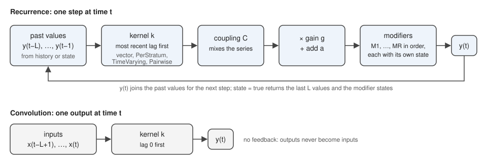

# [API overview](@id api-overview)

This page lists the public names of ComposableRecurrences and what each does.
It covers what one step computes, the two operators, how to call them, the shapes of their inputs, delay distributions, couplings, modifiers and depletion forms.
It then covers time-series processes, executors, and the names for writing new types and checking their gradients.

Some public names are not exported, so `using ComposableRecurrences` does not bring them in.
This page writes them without the package prefix.
Load them with `using ComposableRecurrences: Depletion, Floor, Recent`, and so on.
Internal names, such as `ComposableRecurrences.State`, keep the prefix.
The neural network package Lux also exports a `Recurrence`, so with both loaded write [`ComposableRecurrences.Recurrence`](@ref Recurrence).

## [A step](@id overview-step)

`Recurrence` and `Convolution`, the two operators, compute their outputs one step at a time.
A recurrence computes each value from its own past values, and a convolution from the past values of another series.
Time is the integer step ``t``, counted from 1, and the model sets its [time unit](@ref time-units).
In the Getting started model one step is one day.
A model can run several series side by side, such as one per town.
Each of these series is a stratum, and together they are the strata.

At each step, a recurrence takes a weighted sum of each stratum's recent outputs.
The weights on each lag are its kernel.
A coupling, a matrix of weights between strata, then mixes these sums between strata.
The gain, such as the reproduction number, scales the result.
The values given as `add` are then added.
Modifiers then change the value in turn, such as drawing it from a finite pool.
A modifier can keep a state from step to step, such as the people left to infect.
A convolution takes a weighted sum of an input series, from the current step back, scales it by the gain and adds `add`.
It has no coupling and no modifiers.



A call runs from step `start` to step `stop`.
For each step ``t`` of that range, a recurrence computes

```math
\begin{aligned}
p_t &= \sum_{l=1}^{L} k_l \, y_{t-l} \\
v_t &= \gamma_t \odot K_t \, p_t + a_t \\
y_t &= M_m \circ \dots \circ M_1 (v_t)
\end{aligned}
```

and a convolution computes

```math
y_t = \gamma_t \odot \sum_{l=0}^{L-1} k_l \, x_{t-l} + a_t ,
```

where ``y_t`` is the output, with one entry per stratum.
For a recurrence, the outputs before `start` are the `history`.
For a convolution, the `history` holds the inputs before time 1.
The input of a convolution is ``x_t``.
The kernel has weight ``k_l`` on lag ``l``, and ``L`` lags.
The weighted sum of past outputs is ``p_t``.
The coupling is ``K_t``, and ``v_t`` is the value before the modifiers.
The gain is ``\gamma_t``, and ``a_t`` is `add`.
The modifiers are ``M_1, \dots, M_m``, applied in order.
The symbol ``\odot`` multiplies element by element.

## [Operators](@id overview-operators)

`Recurrence` and `Convolution` are the two [operators](@ref explanation-operators).
Each is built once from a kernel and then called like a function.

```julia
renewal = Recurrence(gi)
delay = Convolution([0.0, 0.1, 0.25, 0.3, 0.2, 0.1, 0.05])
```

| Name | What it does | Returns |
|:--|:--|:--|
| [`Recurrence(kernel; lags, step, coupling, modifiers)`](@ref Recurrence) | computes each value from its own last ``L`` values; `kernel[1]` weights lag 1 | a `Recurrence` to call |
| [`Convolution(kernel; lags, step, method)`](@ref Convolution) | computes each value from the current and past inputs; `kernel[1]` weights lag 0 | a `Convolution` to call |

`lags` and `step` apply when the kernel is a [delay distribution](@ref overview-delays).
The keyword `method` sets how a convolution sums its lags.
The method [`Direct()`](@ref ComposableRecurrences.Direct) sums them one by one.
The method [`FFTMethod()`](@ref ComposableRecurrences.FFTMethod) uses a fast Fourier transform.
By default a convolution takes the transform for a kernel of at least 300 lags over at least 1000 steps.

## [Calls](@id overview-calls)

A call runs an operator over a range of steps.
A recurrence takes its gain first, and a convolution takes its input first and its gain as a keyword.
In the table, `renewal` is a `Recurrence` and `delay` a `Convolution`, as in Getting started.

```julia
infections = renewal(R; history = seed)
reports = delay(infections; gain = 0.4)
```

A [`ComposableRecurrences.State`](@ref ComposableRecurrences.State) holds what a run needs to continue: the last ``L`` outputs, each modifier's state, and `state.t`, the time the next step computes.

| Call | What it does | Returns |
|:--|:--|:--|
| [`renewal(gain; history, add, start, stop)`](@ref Recurrence) | runs the recurrence from step `start` to step `stop` | a vector for one stratum, or strata × time |
| [`delay(x; gain, add, history, start, stop)`](@ref Convolution) | weights the input `x` by the kernel from step `start` to step `stop` | an array shaped like `x` |
| [`ComposableRecurrences.contributions(delay, x; gain, history, start, stop)`](@ref ComposableRecurrences.contributions) | each lag's term before the sum, such as the reports at each time split by delay | lags × time, or strata × lags × time |
| [`delay'(x; tail, start, stop)`](@ref Base.transpose(::Convolution)) | the transpose of `delay`: the sum that reads `x` forward from each time, with `tail` the values after the end of `x` | an array shaped like `x` |
| [`pressure(renewal, y; history, start)`](@ref ComposableRecurrences.pressure) | the coupled weighted sum ``K_t p_t`` at each time ``t``, recomputed from outputs `y` | shaped like `y` |
| [`renewal(gain; history, state = true)`](@ref Recurrence) | runs the recurrence and also returns its `State` at the end | `(y, state)` |
| [`renewal(gain; state)`](@ref Recurrence) | continues a run from a `State`, from time `state.t` | `(y, state)` |
| [`renewal(gain; history, trace = true)`](@ref Recurrence) | runs the recurrence and records what each modifier did at each step | `(y, trace)` |
| [`exponential_history(I0, rate, L)`](@ref ComposableRecurrences.exponential_history) | a history of `L` steps growing by a factor `exp(rate)` per step, ending at `I0` | a vector, or strata × `L` |

Every input that changes over time is [indexed by the time ``t``](@ref explanation-time-base), counted from the first entry of the gain, whatever `start` is.
So the gain at time ``t`` is always `gain[t]`.
`stop` defaults to the common length of those inputs.
Inputs of different lengths without a `stop` are an error.
Without a gain, a recurrence takes a gain of 1.
A `trace` holds one matrix per modifier in `trace.modifiers`, with a column per step.
The output starts at `start`, and `vcat(history, y)` or `hcat(history, y)` [joins the history in front](@ref explanation-returns).
Without modifiers or `add`, the outputs divided by their pressure, `y ./ pressure(renewal, y; history)`, are the gain at each time ``t``.
In a renewal model this is the reproduction number, and with a `Depletion` the effective reproduction number.

## [Shapes](@id overview-shapes)

A [slot](@ref explanation-slots) is a place an operator reads numbers from: a kernel, a coupling or a modifier parameter.
A plain array gives one set of numbers for every stratum and time.
A wrapper, such as `PerStratum`, gives one set per stratum, per pair of strata or per step.
In Getting started, `PerStratum(pop)` gives each town its own population.

```julia
Depletion(PerStratum(pop))
```

A route is one way values pass between strata, such as infection through contact in the community or at funerals.
Each route has its own kernel and its own coupling.

| Name | What it means |
|:--|:--|
| vector | one kernel, the weights on each lag, shared by every stratum |
| [`PerStratum(x)`](@ref PerStratum) | one kernel or parameter for each stratum, with the strata as the first index |
| [`Pairwise(A)`](@ref Pairwise) | one kernel for each pair of strata, indexed by receiving stratum, giving stratum and lag |
| [`Pairwise(K₁ => k₁, K₂ => k₂)`](@ref Pairwise) | a sum of routes, each a coupling and a kernel |
| [`TimeVarying(x)`](@ref TimeVarying) | a kernel, coupling or parameter that changes over time, with time as the last index |
| [`TimeVarying(P, Primary())`](@ref ComposableRecurrences.Primary) | a time-varying kernel whose column ``\tau`` belongs to input time ``\tau`` |
| [`Derived(f, args...)`](@ref ComposableRecurrences.Derived) | a parameter computed by `f` from other parameters, or a cohort kernel computed inside the operator, `TimeVarying(Derived(f, args...), Primary())` |
| [`Survival(h)`](@ref ComposableRecurrences.Survival) | each cohort's survival through a computed kernel's lags against a hazard `h`, as in `TimeVarying(S * (1 - Survival(TimeVarying(h))), Primary())`; [`kernel_weights`](@ref ComposableRecurrences.kernel_weights) returns a computed kernel's weights as an array |
| [`Recent(n)`](@ref ComposableRecurrences.Recent) | a parameter that sums the recurrence's own last `n` outputs, for each stratum and time |

A `Pairwise` kernel, as an array or as routes, mixes the strata itself, so the coupling is left as the identity matrix, `LinearAlgebra.I`.
A `TimeVarying` kernel can be given as a vector with one kernel per step, each of any length.
It can also be given as change points: `start => value` pairs, each value holding from its start time.
By default, column ``\tau`` of a time-varying kernel belongs to output time ``\tau``, [`ComposableRecurrences.Secondary()`](@ref ComposableRecurrences.Secondary).
It holds the weights the output at time ``\tau`` puts on earlier times, such as the delays of the reports at time ``\tau``.
With [`Primary()`](@ref ComposableRecurrences.Primary), column ``\tau`` belongs to input time ``\tau``.
It holds how the value at time ``\tau`` spreads over later times, such as the delays of the infections at time ``\tau``.
For a recurrence, the value at time ``\tau`` is its own output.
The parameter `Derived(exp, TimeVarying(x))` is the exponential of a parameter that changes over time.
The parameter `Recent(7)` sums the last seven outputs, and `β * Recent(7)` is that sum times a number `β`.
The parameter `Recent(7; coupling = K)` mixes the recent outputs between strata.
Wrappers combine: `TimeVarying(PerStratum(G))` is a strata × lags × time kernel.
Most wrappers hold the stored array without copying it.
A bare vector where a single value is expected is an error that names the wrapper to use.
Inputs and outputs are strata × time arrays, histories are strata × time before the run, and none of them is wrapped.

## [Delay distributions](@id overview-delays)

A delay distribution, such as a gamma generation interval, can stand in for a kernel.
The operator turns it into masses: the probability that the delay falls on each whole lag.

```julia
Recurrence(Gamma(2.0, 2.5); lags = 15)
```

`Gamma` comes from the Distributions.jl package, and a continuous delay such as it needs CensoredDistributions.jl loaded.
A type works as a delay when it has a [`delay_masses`](@ref ComposableRecurrences.delay_masses) method, which gives its masses on lags `0` to `lags - 1`.
With [Distributions.jl](@ref extension-distributions) loaded, discrete distributions have masses.
With [CensoredDistributions.jl](@ref extension-censored-distributions) loaded, continuous distributions have them too.
A convolution's kernel starts at lag 0, so it keeps the delay's mass on lag 0.
A recurrence's kernel [starts at lag 1](@ref explanation-lag-origin), so it drops that mass.
So `Convolution(d; lags = 4)` has 4 kernel entries and `Recurrence(d; lags = 4)` has 3.
The keyword `step` is the width of one lag in the delay's unit, 1 by default.
A model with a weekly [time unit](@ref time-units) and delays in days takes `step = 7`.

| Kernel | Holds |
|:--|:--|
| `d` | one delay |
| `(d₁, d₂)` | a [chain of delays](@ref time-units-chained), one after another |
| `PerStratum(ds)` | a vector of delays, one per stratum |
| `Pairwise(D)` | a matrix of delays, with `D[i, j]` the delay of stratum `j` in stratum `i` |
| `TimeVarying(ds, indexing)` | a vector of delays, one per step |
| `Pairwise(K₁ => d₁, K₂ => d₂)` | delays or arrays as route kernels |

The argument `indexing` is `Primary()`, or left out for the default, as for any [time-varying kernel](@ref overview-shapes).
`TimeVarying` also takes `PerStratum` or `Pairwise` of delays, with time last.
`Pairwise` kernels work with `Recurrence` only.
A chain may also hold mass vectors, and it is itself a delay, so it fits wherever `d` does.

## [Couplings](@id overview-couplings)

A coupling sets how much each stratum's past outputs drive each stratum, such as travel between towns.
In Getting started, `K` is a gravity coupling.

```julia
Recurrence(gi; coupling = K)
```

Row ``i`` of a coupling is the stratum that receives, and column ``j`` the stratum that gives.
The coupling [acts](@ref explanation-coupling) on the weighted sums of past outputs, before the gain.

| Name | What it does |
|:--|:--|
| `LinearAlgebra.I`, the identity matrix | no mixing |
| `λ * LinearAlgebra.I`, the identity times a number `λ` | every sum scaled by `λ` |
| strata × strata matrix | mixing such as contact or travel |
| [`TimeVarying(K)`](@ref TimeVarying), with `K` strata × strata × time | mixing that changes over time |
| a type you write | a [new coupling](@ref extending-coupling) |

The matrix can be dense, `Diagonal` or sparse.

## [Modifiers](@id overview-modifiers)

A modifier changes the value of each step after the gain and `add`.
In Getting started, `Depletion(PerStratum(pop))` draws each town's infections from the people left to infect.

```julia
Recurrence(gi; coupling = K, modifiers = (Depletion(PerStratum(pop)),))
```

Modifiers act in [tuple order](@ref explanation-modifier-order), and each keeps its own [state](@ref explanation-modifier-state).
The `add` input enters before every modifier, and an `Add` enters where it sits in the tuple.
A [`Convolution`](@ref) has no modifiers.

A `Depletion` holds pools, such as the people left to infect.
Each pool has a name and a starting size, given as `pools`, such as `(S = N, V = 0.0)`.
The value a step asks for is drawn from the pools.

| Name | What it does | Parameters |
|:--|:--|:--|
| [`Depletion(N, parts...; pools)`](@ref ComposableRecurrences.Depletion) | draws each step's value from a pool | `N`, each starting pool and each part's parameters |
| [`Depletion(cap, Truncate(; into = :O); pools = (:O,))`](@ref ComposableRecurrences.Depletion) | fills pool `:O` up to a capacity `cap` | the capacity |
| [`Flow(from => to, rate; form)`](@ref ComposableRecurrences.Flow) | a part that moves values from pool `from` to pool `to` at each step | the rate |
| [`Redistribute(M; leak)`](@ref ComposableRecurrences.Redistribute) | moves a share of each stratum's value to other strata | `M` |
| [`Add(b)`](@ref ComposableRecurrences.Add) | adds ``b`` at this point in the order | `b` |
| [`Clamp(lo, hi)`](@ref ComposableRecurrences.Clamp) | bounds each value | `lo`, `hi` |
| [`Allocate(groups, total)`](@ref ComposableRecurrences.Allocate) | rescales each group of strata to a known total | `total` |
| [`Transform(f, θ)`](@ref ComposableRecurrences.Transform) | maps each value through ``f(v, \theta)`` | `θ` |

The parts of a `Depletion` are draws and flows, and they act in the order given.
A draw is a [depletion form](@ref overview-variants), and `Depletion(N)` alone draws with `Hazard()`.
A `Flow` names pools by their names in `pools`, and `0` stands for outside the model.
A draw takes each pool's share of the draw as a keyword of its form, such as `Hazard(; weights = (S = 1, V = σ))`.
A small pool cannot give all a step asks for.
A draw's `overflow` keyword sends what it leaves to a second stratum (`:stratum`), to a queue that joins the next step's demand (`:queue`), or nowhere (the default).
A `Depletion` with flows and no draw only moves values between pools, as for patients moving between wards.
A `Redistribute` moves whatever it receives, including values from `add`.
Its matrix `M` has columns that sum to one, so the total is kept.
With `leak = true` a column can sum to less than one, for a share lost on the way.
The function [`movement(K, ε)`](@ref ComposableRecurrences.movement) builds `M` from a kernel `K` and an intensity `ε`, moving a share `ε[q] * K[p, q]` of stratum `q`'s value to stratum `p`.
An `Allocate` keeps each stratum's share of its group.
With `imports = (fraction, pattern)`, a fraction of each total is shared out by a second pattern instead.
Every parameter is a number, `PerStratum(x)`, `TimeVarying(x)`, `TimeVarying(PerStratum(x))`, a `Recent` or a `Derived` of these.
A [pointwise](@ref explanation-modifier-scope) modifier acts on each stratum on its own.
`Add`, `Clamp` and `Transform` are pointwise.
So is a `Depletion` with one pool whose draws leave nothing over.
`Redistribute` and `Allocate` act on several strata.
Each modifier here has its own [hand-written gradient](@ref adjoint-routing).
A `Transform` has one when it is given a `derivative`, or when `f` holds no numbers of its own.

## [Depletion forms](@id overview-variants)

A depletion form sets how a pool gives up what a step asks for.
Each form is a type, passed as an instance.

```julia
Depletion(N, Floor())
```

| Name | What it does | Example |
|:--|:--|:--|
| [`Hazard(α)`](@ref ComposableRecurrences.Hazard) | draws the value as a hazard, so the pool never goes negative; the default | `Depletion(N)` |
| [`Floor(α)`](@ref ComposableRecurrences.Floor) | scales the value by the share of the pool left, with a floor | `Depletion(N, Floor())` |
| [`Truncate()`](@ref ComposableRecurrences.Truncate) | draws what is asked for, up to what is left | `Depletion(Truncate(); pools = (S = B,))` for a budget `B` |
| [`SoftTruncate(κ)`](@ref ComposableRecurrences.SoftTruncate) | a smooth `Truncate()`, with softness `κ` between 0 and 1 | `Depletion(cap, SoftTruncate(0.1; into = :S))` |
| [`Share()`](@ref ComposableRecurrences.Share) | a flow that moves a share of its pool at each step | `Flow(:S => :V, p; form = Share())` moves a share `p` of `:S` to `:V` |
| a type you write | a new depletion form | `Depletion(N, MyForm())` |

The heterogeneity exponent `α` of `Hazard(α)` and `Floor(α)` is one by default; above one, infections slow sooner as the pool shrinks, as when the most susceptible are infected first.
A flow's form is `Hazard()` by default: a rate that competes with the pool's other flows.
With `Truncate()` or `SoftTruncate(κ)` a flow is a count, capped by what remains.
A new depletion form is a type with a [`forward!`](@ref ComposableRecurrences.forward!) method for one step, `Step()`.

## [Time-series processes](@id overview-time-series)

A time-series process, such as a random walk or an autoregression, builds a series from noise ``\epsilon_t``.
Each is a recurrence or a convolution: a recurrence takes the noise as `add`, and a convolution as its input.
As a latent process, one that is not observed, it can drive a gain, such as the reproduction number through its logarithm.

```julia
Recurrence([1.0])(; history = [0.0], add = ϵ)
```

| Process | Maths | Code |
|:--|:--|:--|
| Random walk | ``z_t = z_{t-1} + \epsilon_t`` | `Recurrence([1.0])(; history = [z0], add = ϵ)` |
| Autoregression, AR(p) | ``z_t = \sum_{l=1}^{p} \phi_l z_{t-l} + \epsilon_t`` | `Recurrence(φ)(; history, add = ϵ)` |
| Autoregression with a coefficient that changes over time | ``z_t = \phi_t z_{t-1} + \epsilon_t`` | `Recurrence(TimeVarying(reshape(φ, 1, :)))(; history, add = ϵ)` |
| Moving average, MA(q) | ``z_t = \epsilon_t + \sum_{l=1}^{q} \theta_l \epsilon_{t-l}`` | `Convolution(vcat(1, θ))(ϵ)` |
| Weighted sum of a recurrence's past outputs | ``p_t = \sum_{l=1}^{L} k_l y_{t-l}`` | `Convolution(vcat(0, k))(y; history)` |

These calls have no gain, and the run is as long as `ϵ`.
`reshape(φ, 1, :)` makes a kernel of one lag with a column per step.
The last row recomputes ``p_t`` from a recurrence's output `y`, as operators return only their outputs.

## [Executors](@id overview-executors)

An [executor](@ref executors) sets where an operator's loops run: in order, on threads or on a device such as a GPU.
The default runs in order.

```julia
with(EXECUTOR => Threaded()) do
    renewal(R; history = seed)
end
```

| Name | What it does | Returns |
|:--|:--|:--|
| [`EXECUTOR`](@ref ComposableRecurrences.EXECUTOR) | the executor every call inside a `with` block uses | a setting |
| [`Serial()`](@ref ComposableRecurrences.Serial) | runs the loops in order; the default | an executor |
| [`Threaded()`](@ref ComposableRecurrences.Threaded) | runs the loops on threads | an executor |
| [`Device(backend)`](@ref ComposableRecurrences.Device) | runs the loops on a device, such as a GPU's KernelAbstractions.jl backend | an executor |

`with` comes from `Base.ScopedValues`, and the setting holds inside its block only.

## [Extension API](@id overview-extending)

These names are for writing a [new coupling, modifier or depletion form](@ref extending), and for checking its gradient.
A model built from the package's own parts needs none of them.
A role is one job a new type can do, such as computing a step.
Each role is named by a type with no fields, such as `Step()`.
A new type does its work in a [`forward!`](@ref ComposableRecurrences.forward!) method for each role it has.
The role `Step()` computes one step, and `Init()` the starting state.
The role `Pressure()` is a coupling's mixing, and `ComposableRecurrences.Trace()` a modifier's record for a call with `trace = true`.
The role `ComposableRecurrences.Run()` is an operator's whole call.
An operator's hand-written gradient is its rule.

| Name | What it does | Returns |
|:--|:--|:--|
| [`forward!(m, role, args...)`](@ref ComposableRecurrences.forward!) | the maths of a modifier, coupling or depletion form for one role | writes in place, returns `nothing` |
| [`pullback!(grads, m, role, args...)`](@ref ComposableRecurrences.pullback!) | its hand-written gradient, optional | adds to the cotangents: the gradients of the result with respect to each input |
| [`Step()`](@ref ComposableRecurrences.Step), [`Init()`](@ref ComposableRecurrences.Init), [`Pressure()`](@ref ComposableRecurrences.Pressure), [`ComposableRecurrences.Trace()`](@ref ComposableRecurrences.Trace), [`ComposableRecurrences.Run()`](@ref ComposableRecurrences.Run) | the roles | types with no fields |
| [`ComposableRecurrences.ntrace(m, S)`](@ref ComposableRecurrences.ntrace) | how many rows a modifier's trace has | `Int` |
| [`ComposableRecurrences.uses_adjoint(m, role)`](@ref ComposableRecurrences.uses_adjoint) | whether the rule calls `m`'s `pullback!` for `role` | `Bool` |
| [`blocks(m)`](@ref ComposableRecurrences.blocks) | a modifier's groups of strata | a tuple, or `nothing` |
| [`ComposableRecurrences.ispointwise(m)`](@ref ComposableRecurrences.ispointwise) | whether a modifier acts on each stratum on its own | `Bool` |
| [`nstate(m, S)`](@ref ComposableRecurrences.nstate) | the number of state entries a modifier keeps for `S` strata | `Int` |
| [`param(x, k, t)`](@ref ComposableRecurrences.param) | reads a parameter for stratum `k` at time `t` | a value |
| [`add_param!(x̄, x, v, k, t)`](@ref ComposableRecurrences.add_param!) | adds to a parameter's cotangent | `nothing` |
| [`cotangent(x̄, name)`](@ref ComposableRecurrences.cotangent) | the cotangent of a field | a cotangent, or `nothing` |
| [`ComposableRecurrences.add_cotangent!(x̄, v, idx...)`](@ref ComposableRecurrences.add_cotangent!) | adds to a cotangent | `nothing` |
| [`ComposableRecurrences.depth(x)`](@ref ComposableRecurrences.depth) | how many past outputs a modifier, coupling or kernel reads | `Int` |
| [`ComposableRecurrences.param_eltype(x)`](@ref ComposableRecurrences.param_eltype) | the number type a type's parameters need in the store of past outputs | a type |
| [`PieceInterface`](@ref ComposableRecurrences.PieceInterface) | the conformance test for a new type, built on the Interfaces.jl package | a test result |

For an operator, pass `ComposableRecurrences.Run()` as the role to `ComposableRecurrences.uses_adjoint`, `PieceInterface` and `test_adjoint`.
`blocks` gives `(nv, ns)`, the number of values and of state entries in each group.
It is `(1, 1)` for a pointwise modifier and `nothing` for one that reads every stratum.
`ComposableRecurrences.ispointwise` and `nstate` are read from `blocks`.
A run keeps at least `ComposableRecurrences.depth` past outputs, even when the kernel is shorter.

### [Checking gradients](@id overview-gradients)

A rule can be checked against the gradient that automatic differentiation computes from the operator's code.

| Name | What it does | Returns |
|:--|:--|:--|
| [`NoAdjoint(op)`](@ref ComposableRecurrences.NoAdjoint) | the same operator, differentiated by automatic differentiation instead of its [rule](@ref adjoints-backends) | an operator |
| [`ComposableRecurrences.test_adjoint(backend, op, ComposableRecurrences.Run(), args...)`](@ref ComposableRecurrences.test_adjoint) | runs the rule tester of an automatic differentiation package on an operator's rule | a test result |

The gradient through `NoAdjoint(op)` checks the gradient through `op`, and timing both compares their cost.
`backend` names the automatic differentiation package, such as Mooncake or Enzyme.
`test_adjoint` needs the Mooncake package, or the Enzyme and EnzymeTestUtils packages, loaded.
