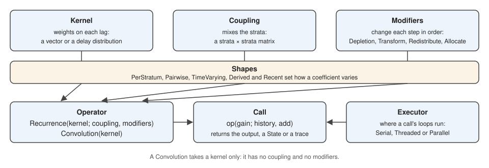
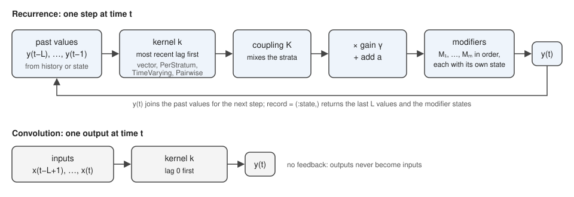

# [API overview](@id api-overview)

Some public names are not exported, so `using ComposableRecurrences` does not bring them in.
They are written here without the package prefix, and `using ComposableRecurrences: Depletion, Floor, Recent` loads them.
Internal names, such as `ComposableRecurrences.State`, keep the prefix.
The neural network package Lux also exports a `Recurrence`, so with both loaded write [`ComposableRecurrences.Recurrence`](@ref Recurrence).
The examples load these packages and names:

```@example api-overview
using ComposableRecurrences
using ComposableRecurrences: Depletion, Floor, EXECUTOR, Threaded
using Base.ScopedValues: with
using Distributions, CensoredDistributions
```

They use `gi`, `T`, `pop`, `K`, `seed` and `R` from the model of [Three towns, step by step](@ref tutorial-three-towns).

```@setup api-overview
include(joinpath(pkgdir(ComposableRecurrences), "docs", "getting_started_model.jl"))
```

## [How the parts fit together](@id overview-map)

An operator is built from a kernel, and a recurrence also from a coupling and modifiers.
A shape sets how each of these coefficients varies across strata and time.
The operator is then called with data, and an executor sets where the call's loops run.



| Part | Section | Explanation |
|:--|:--|:--|
| one step of an operator | [A step](@ref overview-step) | [Operators](@ref explanation-operators) |
| `Recurrence` and `Convolution` | [Operators](@ref overview-operators) | [Operators](@ref explanation-operators) |
| a call and what it returns | [Calls](@ref overview-calls) | [Time base](@ref explanation-time-base) |
| shapes | [Shapes](@ref overview-shapes) | [Slots](@ref explanation-slots) |
| a delay distribution as a kernel | [Delay distributions](@ref overview-delays) | [Time units](@ref time-units) |
| couplings | [Couplings](@ref overview-couplings) | [Where the coupling acts](@ref explanation-coupling) |
| modifiers | [Modifiers](@ref overview-modifiers) | [Modifiers](@ref explanation-modifiers) |
| depletion forms | [Depletion forms](@ref overview-variants) | [Modifiers](@ref explanation-modifiers) |
| time-series processes | [Time-series processes](@ref overview-time-series) | [Latent processes](@ref tutorial-latent-rt) |
| executors | [Executors](@ref overview-executors) | [Executors](@ref executors) |

To write a new coupling, modifier or depletion form, or to check a gradient, see [Writing new types](@ref extending).
It lists the names for this in its [extension API](@ref overview-extending).

## [A step](@id overview-step)

`Recurrence` and [`Convolution`](@ref), the two operators, compute their outputs one step at a time.
Time is the integer step ``t``, counted from 1, and the model sets its [time unit](@ref time-units).
A model can run several series side by side, such as one per town.
Each series is a stratum, and together they are the strata.

At each step, a recurrence:

- takes a weighted sum of each stratum's recent outputs, with weights on each lag from its kernel;
- mixes these sums between strata with the coupling, a matrix of weights between strata;
- scales the result by the gain, such as the reproduction number, and adds `add`;
- passes the value through its modifiers in turn, such as a draw from a finite pool, each keeping its own state.

A convolution takes a weighted sum of an input series, from the current step back, scales it by the gain and adds `add`.
It has no coupling and no modifiers.



A call runs from step `start` to step `stop`.
For each step ``t`` of that range, a recurrence computes

```math
\begin{aligned}
p_t &= \sum_{l=1}^{L} k_l \, y_{t-l} \\
v_t &= \gamma_t \odot K_t \, p_t + a_t \\
y_t &= M_m \circ \dots \circ M_1 (v_t)
\end{aligned}
```

and a convolution computes

```math
y_t = \gamma_t \odot \sum_{l=0}^{L-1} k_l \, x_{t-l} + a_t ,
```

where ``y_t`` is the output, one entry per stratum, ``x_t`` the input of a convolution and ``p_t`` the weighted sum of past outputs.
The kernel has weight ``k_l`` on lag ``l`` over ``L`` lags, ``K_t`` is the coupling, ``\gamma_t`` the gain and ``a_t`` the `add` input.
The value before the modifiers ``M_1, \dots, M_m``, which act in order, is ``v_t``, and ``\odot`` multiplies element by element.
For a recurrence the `history` holds the outputs before `start`, and for a convolution the inputs before time 1.

## [Operators](@id overview-operators)

`Recurrence` and `Convolution` are the two [operators](@ref explanation-operators).
Each is built once from a kernel and then called like a function.

```@example api-overview
renewal = Recurrence(gi)
delay = Convolution([0.0, 0.1, 0.25, 0.3, 0.2, 0.1, 0.05])
delay([10.0, 20.0, 30.0])
```

| Name | What it does | Returns |
|:--|:--|:--|
| [`Recurrence(kernel; lags, step, coupling, modifiers)`](@ref Recurrence) | computes each value from its own last ``L`` values; `kernel[1]` weights lag 1 | a `Recurrence` to call |
| [`Convolution(kernel; lags, step, method)`](@ref Convolution) | computes each value from the current and past inputs; `kernel[1]` weights lag 0 | a `Convolution` to call |

`lags` and `step` apply when the kernel is a [delay distribution](@ref overview-delays).
The keyword `method` sets how a convolution sums its lags: [`Direct()`](@ref ComposableRecurrences.Direct) sums them one by one, and [`FFTMethod()`](@ref ComposableRecurrences.FFTMethod) uses a fast Fourier transform.
By default a convolution takes the transform for a kernel of at least 300 lags over at least 1000 steps.

An operator, modifier or shape wrapper displays in the REPL as one line with its size and parts, such as `Convolution(7 lags)` for `delay`.
`repr` and `string` keep the constructor form.

## [Calls](@id overview-calls)

A call runs an operator over a range of steps.
A recurrence takes its gain first, and a convolution takes its input first and its gain as a keyword.
In the table, `renewal` is a `Recurrence` and `delay` a `Convolution`, as in the three-town model.

```@example api-overview
infections = renewal(R; history = seed)
reports = delay(infections; gain = 0.4, history = seed)
nothing # hide
```

A [`ComposableRecurrences.State`](@ref ComposableRecurrences.State) holds what a run needs to continue: the last ``L`` outputs, each modifier's state, and `state.t`, the time the next step computes.

| Call | What it does | Returns |
|:--|:--|:--|
| [`renewal(gain; history, add, start, stop)`](@ref Recurrence) | runs the recurrence from step `start` to step `stop` | a vector for one stratum, or strata × time |
| [`delay(x; gain, add, history, start, stop)`](@ref Convolution) | weights the input `x` by the kernel from step `start` to step `stop` | an array shaped like `x` |
| [`ComposableRecurrences.contributions(delay, x; gain, history, start, stop)`](@ref ComposableRecurrences.contributions) | each lag's term before the sum, such as the reports at each time split by delay | lags × time, or strata × lags × time |
| [`delay'(x; tail, start, stop)`](@ref Base.transpose(::Convolution)) | the transpose of `delay`: the sum that reads `x` forward from each time, with `tail` the values after the end of `x` | an array shaped like `x` |
| [`pressure(renewal, y; history, start)`](@ref ComposableRecurrences.pressure) | the coupled weighted sum ``K_t p_t`` at each time ``t``, recomputed from outputs `y`; `y` divided by it is the gain as run, such as the [reproduction number](@ref tutorial-reproduction-number) | shaped like `y` |
| [`ComposableRecurrences.window_sums(y, ends; dims)`](@ref ComposableRecurrences.window_sums) | the sums of `y` over consecutive windows along `dims` that end at the times `ends`, the first from time 1, such as daily counts binned to report days | one entry per window in place of `dims` |
| [`renewal(gain; history, record = (:state,))`](@ref Recurrence) | runs the recurrence and also returns its `State` at the end | `(; y, state)` |
| [`renewal(gain; state)`](@ref Recurrence) | continues a run from a `State`, from time `state.t` | `y`, or `(; y, state)` with `record = (:state,)` |
| [`renewal(gain; history, record = (:trace,))`](@ref Recurrence) | runs the recurrence and records what each modifier did and the pressure at each step | `(; y, trace)` |
| [`exponential_history(I0, rate, L)`](@ref ComposableRecurrences.exponential_history) | a history of `L` steps growing by a factor `exp(rate)` per step, ending at `I0` | a vector, or strata × `L` |

The transpose sums forward in time from each ``t``.
For a reporting delay ``w_l`` over ``L_w`` lags and data up to time ``T``, the share of the infections at time ``t`` reported by ``T`` is

```math
c_t = \sum_{l=0}^{\min(L_w, T - t + 1) - 1} w_l ,
```

and `delay'(ones(T))` returns ``c_1, \dots, c_T``.
For a delay whose weights sum to 1, it is 1 up to ``T - L_w + 1`` and falls to ``w_0`` at ``T``.

Every input that changes over time is [indexed by the time ``t``](@ref explanation-time-base), counted from the first entry of the gain, whatever `start` is, so the gain at time ``t`` is always `gain[t]`.
The keyword `stop` defaults to the common length of those inputs, and inputs of different lengths without a `stop` are an error.
Without a gain, a recurrence takes a gain of 1.
A `trace` holds one matrix per modifier in `trace.modifiers`, with a column per step, and the pressure of each step in `trace.pressure`, shaped like `y`.
The output starts at `start`, and `vcat(history, y)` or `hcat(history, y)` [joins the history in front](@ref explanation-returns).

## [Shapes](@id overview-shapes)

A shape is how a coefficient varies across strata and time.
[Slots and shapes](@ref explanation-slots) says which wrappers each slot takes, and [Nesting](@ref explanation-nesting) how they combine.
In the three-town model, `PerStratum(pop)` gives each town its own population.

```@example api-overview
Depletion(PerStratum(pop))
nothing # hide
```

A route is one way values pass between strata, such as contact in the community or at funerals, with its own kernel and coupling.

| Name | What it means |
|:--|:--|
| vector | one kernel, the weights on each lag, shared by every stratum |
| [`PerStratum(x)`](@ref PerStratum) | one kernel or parameter for each stratum, with the strata as the first index |
| [`Pairwise(A)`](@ref Pairwise) | one kernel for each pair of strata, indexed by receiving stratum, giving stratum and lag |
| [`Pairwise(K₁ => k₁, K₂ => k₂)`](@ref Pairwise) | a sum of routes, each a coupling and a kernel |
| [`TimeVarying(x)`](@ref TimeVarying) | a kernel, coupling or parameter that changes over time, with time as the last index |
| [`TimeVarying(P, Primary())`](@ref ComposableRecurrences.Primary) | a time-varying kernel whose column ``\tau`` belongs to input time ``\tau`` |
| [`Derived(f, args...)`](@ref ComposableRecurrences.Derived) | a parameter computed by `f` from other parameters, or a cohort kernel computed inside the operator, `TimeVarying(Derived(f, args...), Primary())` |
| [`Survival(h)`](@ref ComposableRecurrences.Survival) | each cohort's survival through a computed kernel's lags against a hazard `h`, as in `TimeVarying(S * (1 - Survival(TimeVarying(h))), Primary())` |
| [`Recent(n)`](@ref ComposableRecurrences.Recent) | a parameter that sums the recurrence's own last `n` outputs, for each stratum and time |

Kernels:

- A `TimeVarying` kernel can be a vector with one kernel per step, each of any length.
  It can also be change points: `start => value` pairs, each value holding from its start time.
- By default, column ``\tau`` of a time-varying kernel belongs to output time ``\tau``, [`ComposableRecurrences.Secondary()`](@ref ComposableRecurrences.Secondary).
  It holds the weights the output at ``\tau`` puts on earlier times, such as the delays of the reports at ``\tau``.
- With [`Primary()`](@ref ComposableRecurrences.Primary), column ``\tau`` belongs to input time ``\tau``.
  It holds how the value at ``\tau`` spreads over later times, such as the delays of the infections at ``\tau``.
  For a recurrence, the value at ``\tau`` is its own output.

Parameters:

- `Derived(exp, TimeVarying(x))` is the exponential of a parameter that changes over time.
- `Recent(7)` sums the last seven outputs, `β * Recent(7)` scales that sum, and `Recent(7; coupling = K)` mixes it between strata.

All wrappers:

- Most wrappers hold the stored array without copying it.
- A bare vector where a single value is expected is an error that names the wrapper to use.

Inputs, outputs and histories are data, not slots, so they are never wrapped.
They are strata × time arrays, or a vector for a single series.
The call's `gain` and `add` take three shapes:

| Shape | What it means |
|:--|:--|
| scalar | one value for every stratum and time |
| length-`T` vector | one value per time, shared by every stratum |
| `S × T` matrix | one value per stratum and time |

- A bare vector is always read as time.
  So a value per stratum that is constant over time is `repeat(ρ, 1, T)`, with `ρ` a vector of `S` values.
- For a convolution without `add`, the same is `ρ .* c(x)`, which scales row `i` of the output by `ρ[i]`.
- In a recurrence, a receiving stratum's susceptibility can instead go in the rows of the coupling, as [Where the coupling acts](@ref explanation-coupling) shows.

```jldoctest
using ComposableRecurrences
ρ, T = [1.0, 2.0], 3
h = ones(2, 1)
by_gain = Recurrence([0.5])(repeat(ρ, 1, T); history = h)
by_rows = Recurrence([0.5]; coupling = ρ .* [1 0; 0 1])(; history = h, stop = T)
by_gain == by_rows

# output

true
```

## [Delay distributions](@id overview-delays)

A delay distribution, such as a gamma generation interval, can stand in for a kernel.
The operator turns it into masses: the probability that the delay falls on each whole lag.

```@example api-overview
Recurrence(Gamma(2.0, 2.5); lags = 15)
masses = ComposableRecurrences.delay_masses(Gamma(2.0, 2.5), 15)
round(masses[1]; digits = 3), round(sum(masses[2:end]); digits = 3)
```

The recurrence keeps the masses on lags 1 to 14, 0.957 of the delay, and drops the mass of 0.022 on lag 0.

`Gamma` comes from the Distributions.jl package, and a continuous delay such as it needs CensoredDistributions.jl loaded.
A type works as a delay when it has a [`delay_masses`](@ref ComposableRecurrences.delay_masses) method, which gives its masses on lags `0` to `lags - 1`.

A delay type of its own, with masses ``p (1 - p)^l`` on whole units, and the masses of `step` units summed for a lag:

```jldoctest
using ComposableRecurrences
struct GeometricDelay
    p::Float64
end
function ComposableRecurrences.delay_masses(d::GeometricDelay, lags; step = 1)
    q = (1 - d.p)^step
    return map(l -> (1 - q) * q^l, 0:(lags - 1))
end
Convolution(GeometricDelay(0.5); lags = 3).kernel,
Recurrence(GeometricDelay(0.5); lags = 3, step = 2).kernel

# output

([0.5, 0.25, 0.125], [0.1875, 0.046875])
```

With [Distributions.jl](@ref extension-distributions) loaded, discrete distributions have masses.
With [CensoredDistributions.jl](@ref extension-censored-distributions) loaded, continuous distributions have them too.
A convolution's kernel starts at lag 0, so it keeps the delay's mass on lag 0.
A recurrence's kernel [starts at lag 1](@ref explanation-lag-origin), so it drops that mass.
So `Convolution(d; lags = 4)` has 4 kernel entries and `Recurrence(d; lags = 4)` has 3.
The keyword `step` is the width of one lag in the delay's unit, 1 by default.
A model with a weekly [time unit](@ref time-units) and delays in days takes `step = 7`.

| Kernel | Holds |
|:--|:--|
| `d` | one delay |
| `(d₁, d₂)` | a [chain of delays](@ref time-units-chained), one after another |
| `PerStratum(ds)` | a vector of delays, one per stratum |
| `Pairwise(D)` | a matrix of delays, with `D[i, j]` the delay of stratum `j` in stratum `i` |
| `TimeVarying(ds, indexing)` | a vector of delays, one per step |
| `Pairwise(K₁ => d₁, K₂ => d₂)` | delays or arrays as route kernels |

The argument `indexing` is `Primary()`, or left out for the default, as for any [time-varying kernel](@ref overview-shapes).
`TimeVarying` also takes `PerStratum` or `Pairwise` of delays, with time last.
`Pairwise` kernels work with `Recurrence` only.
A chain may also hold mass vectors, and it is itself a delay, so it fits wherever `d` does.

## [Couplings](@id overview-couplings)

A coupling sets how much each stratum's past outputs drive each stratum, such as travel between towns.
In the three-town model, `K` is a gravity coupling.

```@example api-overview
totals = vec(sum(Recurrence(gi; coupling = K)(R; history = seed); dims = 2))
round.(totals ./ totals[1]; digits = 3)
```

Towns B and C have 3.4% and 1.9% of town A's infections, all from the coupling, as only town A is seeded.
This run has no depletion, so its totals exceed the towns' populations.

Row ``i`` of a coupling is the stratum that receives, and column ``j`` the stratum that gives.
The coupling [acts](@ref explanation-coupling) on the weighted sums of past outputs, before the gain.

| Name | What it does |
|:--|:--|
| `LinearAlgebra.I`, the identity matrix | no mixing |
| `λ * LinearAlgebra.I`, the identity times a number `λ` | every sum scaled by `λ` |
| strata × strata matrix | mixing such as contact or travel |
| [`TimeVarying(K)`](@ref TimeVarying), with `K` strata × strata × time | mixing that changes over time |
| a type you write | a [new coupling](@ref extending-coupling) |

The matrix can be dense, `Diagonal` or sparse.

## [Modifiers](@id overview-modifiers)

A modifier changes the value of each step after the gain and `add`.
Modifiers act in [tuple order](@ref explanation-modifier-order), each keeps its own [state](@ref explanation-modifier-state), and [Scope](@ref explanation-modifier-scope) says which strata each reads.
The `add` input enters before every modifier, and a [`Transform(+, b)`](@ref ComposableRecurrences.Transform) enters where it sits in the tuple.
In the three-town model, a [`Depletion`](@ref ComposableRecurrences.Depletion) of `PerStratum(pop)` draws each town's infections from the people left to infect.

```@example api-overview
depleted = Recurrence(gi; coupling = K, modifiers = (Depletion(PerStratum(pop)),))
depleted(R; history = seed)
nothing # hide
```

| Name | What it does | Parameters |
|:--|:--|:--|
| [`Depletion(N, parts...; pools)`](@ref ComposableRecurrences.Depletion) | draws each step's value from a pool | `N`, each starting pool and each part's parameters |
| [`Depletion(cap, Truncate(; into = :O); pools = (:O,))`](@ref ComposableRecurrences.Depletion) | fills pool `:O` up to a capacity `cap` | the capacity |
| [`Flow(from => to, rate; form)`](@ref ComposableRecurrences.Flow) | a part that moves values from pool `from` to pool `to` at each step | the rate |
| [`Redistribute(M; leak)`](@ref ComposableRecurrences.Redistribute), `Redistribute(K, ε; leak)` | moves a share of each stratum's value to other strata | `M`, or `K` and `ε` |
| [`Transform(+, b)`](@ref ComposableRecurrences.Transform) | adds ``b`` at this point in the order | `b` |
| [`Transform(clamp, lo, hi)`](@ref ComposableRecurrences.Transform) | bounds each value | `lo`, `hi` |
| [`Allocate(groups, total)`](@ref ComposableRecurrences.Allocate) | rescales each group of strata to a known total | `total` |
| [`Transform(f, θ)`](@ref ComposableRecurrences.Transform) | maps each value through ``f(v, \theta)`` | `θ` |

A `Depletion` holds named pools, such as the people left to infect.

- Pools: `pools` gives each pool's name and starting size, such as `(S = N, V = 0.0)`, and a step draws its value from them.
- Parts: draws and flows, acting in the order given.
- Draws:
  - A draw is a [depletion form](@ref overview-variants), and `Depletion(N)` alone draws with [`Hazard()`](@ref ComposableRecurrences.Hazard).
  - It takes each pool's share as a keyword of its form, such as `Hazard(; weights = (S = 1, V = σ))`.
  - A small pool cannot give all a step asks for.
    The draw's `overflow` keyword sends the rest to a second stratum (`:stratum`), to a queue that joins the next step's demand (`:queue`), or nowhere (the default).
- Flows:
  - A `Flow` names pools by their names in `pools`, and `0` stands for outside the model.
  - With flows and no draw, a `Depletion` only moves values between pools, as for patients moving between wards.

`Redistribute` and `Allocate` act on several strata.

- A `Redistribute` moves whatever it receives, including values from `add`.
  The columns of its matrix `M` sum to one, so the total is kept; with `leak = true` a column can sum to less, for a share lost on the way.
- [`Redistribute(K, ε)`](@ref ComposableRecurrences.Redistribute) builds `M`, moving a share `ε[q] * K[p, q]` of stratum `q`'s value to stratum `p`.
- An `Allocate` keeps each stratum's share of its group.
  With `imports = (fraction, pattern)`, a fraction of each total is shared out by a second pattern instead.

Each modifier here has its own [hand-written gradient](@ref adjoint-routing).
A `Transform` has one when it is given a `derivative`, or when `f` holds no numbers of its own.

## [Depletion forms](@id overview-variants)

A depletion form sets how a pool gives up what a step asks for.
Each form is a type, passed as an instance.

```@example api-overview
N = 60_000.0
floored = Recurrence(gi; modifiers = (Depletion(N, Floor()),))
floored(fill(1.8, T); history = fill(10.0, 6))
nothing # hide
```

| Name | What it does | Example |
|:--|:--|:--|
| [`Hazard(α)`](@ref ComposableRecurrences.Hazard) | draws the value as a hazard, so the pool never goes negative; the default | `Depletion(N)` |
| [`Floor(α)`](@ref ComposableRecurrences.Floor) | scales the value by the share of the pool left, with a floor | `Depletion(N, Floor())` |
| [`Truncate()`](@ref ComposableRecurrences.Truncate) | draws what is asked for, up to what is left | `Depletion(Truncate(); pools = (S = B,))` for a budget `B` |
| [`Truncate(κ)`](@ref ComposableRecurrences.Truncate) | a smooth `Truncate()`, with softness `κ` in [0, 1), where 0 is `Truncate()` | `Depletion(cap, Truncate(0.1; into = :S))` |
| [`Share()`](@ref ComposableRecurrences.Share) | a flow that moves a share of its pool at each step | `Flow(:S => :V, p; form = Share())` moves a share `p` of `:S` to `:V` |
| a type you write | a new depletion form | `Depletion(N, MyForm())` |

- `α` in `Hazard(α)` and `Floor(α)` is the heterogeneity exponent, one by default.
  Above one, infections slow sooner as the pool shrinks, as when the most susceptible are infected first.
- A flow's form is `Hazard()` by default, a rate that competes with the pool's other flows.
  With `Truncate()` or `Truncate(κ)` a flow is a count, capped by what remains.
- A new form is a type with a [`forward!`](@ref ComposableRecurrences.forward!) method for one step, [`Step()`](@ref ComposableRecurrences.Step); see [A depletion form](@ref extending-form).

## [Time-series processes](@id overview-time-series)

A time-series process, such as a random walk or an autoregression, builds a series from innovations ``\epsilon_t``.
Each is a recurrence or a convolution: a recurrence takes the innovations as `add`, and a convolution as its input.
As a latent process, one that is not observed, it can drive a gain, such as the reproduction number through its logarithm.

```@example api-overview
ϵ = [0.5, -0.25, 0.125, 0.25, -0.5]
Recurrence([1.0])(; history = [0.0], add = ϵ)
```

| Process | Maths | Code |
|:--|:--|:--|
| Random walk | ``z_t = z_{t-1} + \epsilon_t`` | `Recurrence([1.0])(; history = [z0], add = ϵ)` |
| Autoregression, AR(p) | ``z_t = \sum_{l=1}^{p} \phi_l z_{t-l} + \epsilon_t`` | `Recurrence(φ)(; history, add = ϵ)` |
| Autoregression with a coefficient that changes over time | ``z_t = \phi_t z_{t-1} + \epsilon_t`` | `Recurrence(TimeVarying(reshape(φ, 1, :)))(; history, add = ϵ)` |
| Moving average, MA(q) | ``z_t = \epsilon_t + \sum_{l=1}^{q} \theta_l \epsilon_{t-l}`` | `Convolution(vcat(1, θ))(ϵ)` |
| Weighted sum of a recurrence's past outputs | ``p_t = \sum_{l=1}^{L} k_l y_{t-l}`` | `Convolution(vcat(0, k))(y; history)` |

These calls have no gain, and the run is as long as `ϵ`.
`reshape(φ, 1, :)` makes a kernel of one lag with a column per step.
The last row recomputes ``p_t`` from a recurrence's output `y`, as operators return only their outputs.

## [Executors](@id overview-executors)

An [executor](@ref executors) sets where an operator's loops run: in order, on threads or on a device such as a GPU.
The default runs in order.

```@example api-overview
y = with(EXECUTOR => Threaded()) do
    renewal(R; history = seed)
end
y ≈ renewal(R; history = seed)
```

| Name | What it does | Returns |
|:--|:--|:--|
| [`EXECUTOR`](@ref ComposableRecurrences.EXECUTOR) | the executor every call inside a `with` block uses | a setting |
| [`Serial()`](@ref ComposableRecurrences.Serial) | runs the loops in order; the default | an executor |
| [`Threaded()`](@ref ComposableRecurrences.Threaded) | runs the loops on threads | an executor |
| [`Parallel(backend)`](@ref ComposableRecurrences.Parallel) | runs each loop as one kernel on a KernelAbstractions.jl backend, such as a GPU's; [`Device(backend)`](@ref ComposableRecurrences.Device) makes the same | an executor |
| [`convert_floats(T, x)`](@ref ComposableRecurrences.convert_floats) | converts every float a model holds, scalars included, to `T`; needs Functors.jl | the model |

`with` comes from `Base.ScopedValues`, and the setting holds inside its block only.
